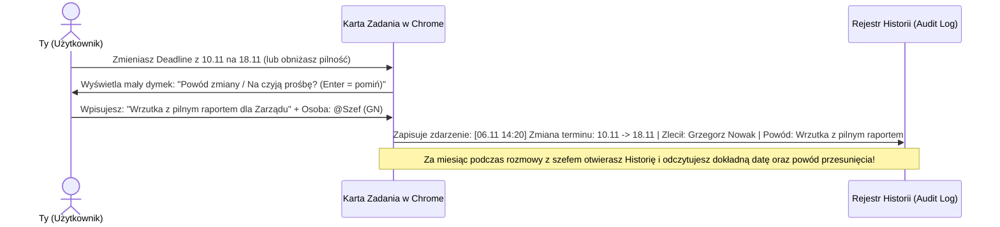

# KOMPLETNY PROJEKT OD A DO Z: FOKUS SOLO (CHROME EDITION)
## Bezserwerowy System Zarządzania Zadaniami, Czasem i Historią Zmian (Single-Player Local-First)

**Środowisko docelowe:** Google Chrome (Windows / macOS) | Architektura 100% Lokalna (Plik `fokus-db.json` w folderze OneDrive)  
**Tryb pracy:** Jednoosobowy (Solo) | Motyw: Jasny i Ciemny (z przełącznikiem)

---

## 1. Architektura Systemu i Działanie w Google Chrome

Aplikacja działa w $100\%$ bezserwerowo w przeglądarce **Google Chrome** jako lokalna aplikacja webowa (Single-File HTML lub zainstalowane PWA). Żadne dane nie są wysyłane do internetu – cała baza spoczywa w jednym pliku `fokus-db.json` w Twoim folderze OneDrive.

```mermaid
flowchart LR
    subgraph Chrome["Przeglądarka Google Chrome (Motyw Jasny / Ciemny)"]
        UI["Interfejs Użytkownika<br/>(Kokpit, Eisenhower, Raporty, Słowniki)"]
        Engine["Silnik Logiczny<br/>(Algorytm Pilności MAX, Pomodoro, Audit Log)"]
        IDB["Pamięć IndexedDB<br/>(Cache 0 ms + Uchwyt do pliku)"]
    end

    subgraph OneDrive["Lokalny Folder OneDrive na Dysku"]
        AppHTML["Fokus_Chrome.html<br/>(Plik uruchomieniowy aplikacji)"]
        MainDB["fokus-db.json<br/>(Zadania, Słowniki, Sesje, Historia Zmian)"]
        Backups["backups/fokus-YYYY-MM-DD.json<br/>(Automatyczne kopie dzienne)"]
    end

    UI <--> Engine
    Engine <--> IDB
    Engine <-->|File System Access API (Zapis atomowy)| MainDB
    Engine -->|Kopia przy pierwszym starcie dnia| Backups
```

### Jak wygląda codzienny start pracy w Chrome?
1. Otwierasz aplikację w Google Chrome (możesz przypiąć ją do paska zadań Windows przyciskiem *„Zainstaluj aplikację”* w pasku adresu Chrome).
2. Aplikacja natychmiast wczytuje dane z lokalnego cache'u `IndexedDB` (czas ładowania $< 10\text{ ms}$) i wyświetla na górze pasek: **`[ Połącz z plikiem OneDrive (Wciśnij Enter) ]`**.
3. Po pojedynczym wciśnięciu `Enter` Chrome aktywuje uprawnienia zapisu do `fokus-db.json` na całą sesję roboczą. Każda zmiana w zadaniu, odhaczenie kroku czy zakończona sesja Pomodoro zapisuje się automatycznie na dysku.

---

## 2. Anatomia Zadania i Słowniki Inteligentne (Model Wejściowy)

Każde zadanie opiera się na szybkiej strukturze wejściowej wspieranej przez słowniki z wyszukiwaniem i automatyczny dziennik zmian.

### 2.1. Pola Zadania (Struktura Karty)

| Sekcja | Pole | Działanie i Logika Biznesowa |
| :--- | :--- | :--- |
| **1. CO?** | **Tytuł zadania** | Konkretny rezultat do dowiezienia (np. *„Analiza ofert na transport morski Q1”*). |
| **2. DLA KOGO i KATEGORIA?** | **Osoba (Słownik z aliasami)** | Wybór osoby z autouzupełnianiem po nazwie głównej lub ukrytych aliasach (np. wpisujesz `gp` lub `prezes` $\rightarrow$ wybiera `Grzegorz Kowalski`). Możliwość dodania nowej osoby w locie (`+ Dodaj do słownika`). |
| | **Kategoria (Słownik własny)** | Wybór kategorii definiowanej przez Ciebie (np. `#ERP`, `#Raport`, `#RFQ`, `#Analiza Ad-hoc`) z przypisanym kolorem. |
| **3. JAK PILNE?** | **Tag Pilności + Deadline** | Wybór kategorii tekstowej (`ASAP`, `Pilne`, `Standard`, `Last`) ORAZ opcjonalny wybór daty końcowej (`Deadline`). Algorytm sam podbija pilność w miarę zbliżania się daty. |
| **4. JAK WAŻNE?** | **Waga Zadania** | Wybór: `Ważne (Strategiczne / Wysoka wartość)` lub `Standardowe (Operacyjne / Rutynowe)` – determinuje oś pionową w Macierzy Eisenhowera. |
| **5. OPIS, NOTATKI I KROKI** | **Checklista Kroków (SOP)** | Interaktywna lista podpunktów (z paskiem postępu $\%$). Możliwość wczytania gotowego szablonu dla zadań cyklicznych. |
| | **Wspólne Pole Kontekstu / Notatek** | Jedno zunifikowane pole tekstowe na opis początkowy, linki do folderów, numery dokumentów oraz bieżące notatki robocze dopisywane w trakcie pracy. |
| **6. CYKLICZNOŚĆ** | **Reguła odnawiania** | Opcjonalnie: `Brak`, `Co tydzień`, `Początek miesiąca`, `Koniec miesiąca` (po zamknięciu zadania tworzy się nowa kopia na kolejny okres). |

---

### 2.2. Słownik Osób z Ukrytymi Aliasami (Jak działa wyszukiwanie?)

W zakładce **Słowniki** (oraz w locie podczas tworzenia zadania) definiujesz osoby, dla których pracujesz lub od których zależysz:

* **Rekord w słowniku:**
  * **Nazwa główna (wyświetlana wszędzie w UI i raportach):** `Grzegorz Nowak (Dyrektor)`
  * **Aliasy wyszukiwania (ukryte na listach):** `["grzesiek", "gn", "prezes", "szef", "dyrektor"]`
* **Mechanizm działania w polu wyboru:**
  Gdy w polu *„Dla kogo?”* lub *„Kto zlecił zmianę?”* wpiszesz z klawiatury `szef` albo `gn`, lista podpowiedzi natychmiast zawęża się i pokazuje czystą pozycję **`Grzegorz Nowak (Dyrektor)`**. Wciśnięcie `Enter` przypisuje właściwą osobę. Dzięki temu na wykresach kwartalnych nigdy nie powstaną duplikaty.

---

### 2.3. Algorytm Dynamicznej Pilności (Tag Tekstowy + Deadline)

Użytkownik może przypisać zadaniu jeden z 4 tagów tekstowych pilności, którym odpowiadają wagi liczbowe od $1$ do $4$:
* `Last (Może poczekać)` $= 1$
* `Standard` $= 2$
* `Pilne (Ten tydzień)` $= 3$
* `ASAP (Pożar dziś!)` $= 4$

Jeśli dodatkowo w zadaniu ustawiono datę **Deadline (`dueDate`)**, aplikacja oblicza liczbę dni roboczych pozostałych do terminu ($\Delta d = \text{dueDate} - \text{Dziś}$) i wyznacza **Pilność z Daty**:
$$U_{\text{data}}(\Delta d) = \begin{cases} 4 \text{ (ASAP)} & \text{gdy } \Delta d \le 1 \text{ dzień (dziś, jutro lub po terminie)} \\ 3 \text{ (Pilne)} & \text{gdy } 2 \le \Delta d \le 4 \text{ dni} \\ 2 \text{ (Standard)} & \text{gdy } 5 \le \Delta d \le 10 \text{ dni} \\ 1 \text{ (Last)} & \text{gdy } \Delta d > 10 \text{ dni} \end{cases}$$

**Efektywna Pilność Zadania ($U_{\text{eff}}$)** to zawsze wartość wyższa z obu tych wskaźników:
$$U_{\text{eff}} = \max\left(U_{\text{tag}}, \, U_{\text{data}}(\Delta d)\right)$$

* **Przykład:** Wrzucasz zadanie z tagiem `Last` ($1$), ale ustawiasz mu deadline na piątek za 2 tygodnie. Przez pierwszy tydzień zadanie spokojnie leży jako niepilne. Na 4 dni przed piątkiem aplikacja automatycznie podnosi jego status do `Pilne` ($3$) i przesuwa je w Macierzy Eisenhowera na lewą stronę, a w czwartek podbija je do `ASAP` ($4$) z czerwoną odznaką *„Podbite przez zbliżający się termin!”*.

---

## 3. Pełna Historia Zadania i „Dupochron Korporacyjny” (Audit Log)

Każde zadanie posiada wbudowany dziennik zdarzeń (`auditLog[]`). Część zmian zapisuje się całkowicie w tle, a zmiany kluczowych parametrów (terminu, priorytetu, statusu blokady) wywołują lekki mikro-prompt o podanie powodu.



### Co dokładnie rejestruje Historia Zadania?
1. **Zdarzenia automatyczne (0 kliknięć):**
   * Utworzenie zadania (data, godzina, początkowe parametry: termin, pilność, dla kogo).
   * Zmiana statusu (np. `Do zrobienia` $\rightarrow$ `W toku` $\rightarrow$ `Ukończone`).
   * Odhaczenie lub dodanie kroku na checkliście.
   * Zarejestrowanie sesji czasowej Pomodoro lub wpisu ręcznego.
2. **Zdarzenia chronione mikro-promptem (z opcjonalnym powodem i osobą zlecającą):**
   * **Zmiana daty Deadline (`dueDate`):** zapisuje starą datę, nową datę, opcjonalną osobę ze słownika (np. *Na prośbę: Grzegorz Nowak*) oraz krótki powód.
   * **Zmiana Pilności lub Ważności:** zapisuje poprzedni i nowy poziom wraz z uzasadnieniem.
   * **Przejście w stan `Czekam na... (Waiting For)`:** zapisuje od kiedy zadanie czeka, na jaką osobę ze słownika i czego dokładnie brakuje.
3. **Wpis ręczny (Notatka audytowa):**
   * W każdej chwili na karcie zadania możesz kliknąć `+ Dodaj wpis do historii` (np. *„Telefon od Marka – prosił o wstrzymanie kalkulacji do wtorku”*).

---

## 4. Silnik Czasu: Pomodoro + Tryb Overtime + Wpis „Z Palca”

Moduł pomiaru czasu został zaprojektowany tak, aby zbierać dokładne dane do wykresów, a jednocześnie nie przerywać pracy w połowie skomplikowanego zadania.

### 4.1. Trzy sposoby rejestrowania sesji czasowych:
1. **Szybki Start Pomodoro (Presety):**
   * Klikasz przycisk `▶ Start` przy zadaniu i wybierasz jednym kliknięciem: **`15 min`**, **`25 min`**, **`45 min`**, **`60 min`** lub **`90 min`**.
2. **Własny czas odliczania:**
   * Wpisujesz z klawiatury dowolną liczbę minut (np. `35`) i uruchamiasz odliczanie.
3. **Dodanie sesji „z palca” (Gdy zapomniałeś włączyć stoper):**
   * Klikasz ikonę `➕ Dopisz czas` na zadaniu.
   * Wpisujesz: **Czas trwania (np. `40 min`)**, **Datę (domyślnie: `Dziś`)**, **Liczbę sesji (domyślnie: `1`)** oraz opcjonalny komentarz. Sesja trafia do statystyk dokładnie tak samo jak sesja ze stopera.

### 4.2. Mechanizm „Overtime” (Brak ucinania skupienia po wybiciu 00:00)
* Gdy odliczanie Pomodoro dojdzie do `00:00`, aplikacja wydaje łagodny sygnał dźwiękowy (oraz powiadomienie systemowe Chrome), zalicza wykonaną sesję, ale **nie wyłącza licznika**.
* Stoper automatycznie przechodzi w tryb **Nadgodzin Skupienia (`OVERTIME: +00:01`, `+00:02`...)** podświetlony na zielono.
* Możesz spokojnie dokończyć myśl w arkuszu kalkulacyjnym i dopiero po 7 minutach kliknąć **`[ ⏹ Zakończ i zapisz (32 min) ]`** – w raporcie zapisze się pełne $32\text{ minuty}$ zamiast uciętych $25\text{ minut}$!

---

## 5. Wygląd i Działanie Aplikacji (5 Zakładek w Chrome)

Interfejs posiada w prawym górnym rogu przełącznik **Motywu (`☀️ Jasny / 🌙 Ciemny`)** oraz szybki pasek dodawania zadania dostępny pod klawiszem `N`.

### Widok 1: 🎯 Mój Dzień (Kokpit Wykonawczy)
Twój główny ekran podczas pracy. Chroni przed chaosem i pokazuje tylko to, co wybrałeś na dzisiaj (max 6 zadań):

```text
+--------------------------------------------------------------------------------------------------------+
| ⚡ FOKUS SOLO   [🎯 Mój Dzień] [🧭 Macierz & Pula] [⏳ Czekam na (2)] [📊 Raporty] [⚙️ Słowniki]  [🌙/☀️] |
+--------------------------------------------------------------------------------------------------------+
| [ + Nowe Zadanie (N) ]   [ ➕ Dopisz czas z palca ]                  [💾 Plik: fokus-db.json (Zapisano)]|
+--------------------------------------------------------------------------------------------------------+
|                                                                                                        |
| ⏱️ AKTYWNA SESJA POMODORO (Zadanie #1):                                                                 |
| +----------------------------------------------------------------------------------------------------+ |
| | 🟢 W TOKU: Walidacja cennika opakowań 2027               [Dla: Grzegorz Nowak] [Kat: #Analizy RFQ] | |
| |    Pilność: 🔥 ASAP (Deadline: Jutro!) | Ważność: ⭐ Ważne | Sesje: 3 (Łącznie: 1h 25m)             | |
| |                                                                                                    | |
| |    ZEGAR: [ 14:22 pozostało z 25:00 ]    [ +10 min ]   [ ⏸ Pauza ]   [ ⏹ Zakończ i zapisz sesję ]  | |
| |                                                                                                    | |
| |    KROKI DO WYKONANIA (Postęp: 2/4 - 50%):                                                         | |
| |    [X] 1. Pobranie ofert od dostawców                                                              | |
| |    [X] 2. Standaryzacja jednostek w Excelu                                                         | |
| |    [ ] 3. Wyliczenie odchyleń r/r                        [NOTATKI / KONTEKST (1 wspólne pole):   ] | |
| |    [ ] 4. Wysłanie tabeli do Grzegorza                   [ Ścieżka: S:\Zakupy\2026\Opakowania    ] | |
| |                                                          [ Uwzględnić nowy rabat wolumenowy 3%   ] | |
| |                                                                                                    | |
| |    [ 📜 Historia zmian (3) ]   [ 📅 Zmień termin / pilność ]   [ ⏳ Czekam na kogoś ]   [ ✅ Gotowe ]| |
| +----------------------------------------------------------------------------------------------------+ |
|                                                                                                        |
| 📋 POZOSTAŁE ZADANIA NA DZIŚ (Kolejka):                                                                 |
|  2. [🔥 ASAP]   Weryfikacja indeksów ERP         | Dla: Anna K.     | #ERP     | 0/3 kroki | [▶ Start] |
|  3. [⚡ Pilne]  Raport miesięczny Spendu (Cyklicz)| Dla: Zarząd      | #Raporty | 2/5 kroki | [▶ Start] |
|  4. [Standard]  Sprawdzenie warunków Incoterms   | Dla: Marek W.    | #Zakupy  | Brak      | [▶ Start] |
+--------------------------------------------------------------------------------------------------------+
```

---

### Widok 2: 🧭 Macierz Eisenhowera & Pełna Pula Zadań
Widok do planowania tygodnia i zarządzania wszystkimi zadaniami. Posiada filtry po **Osobie** (z wyszukiwaniem po aliasach) oraz po **Kategorii**.
* **Kwadrant I (Pilne i Ważne – Zrób dzisiaj):** Zadania z pilnością `ASAP` lub `Pilne` (w tym podbite przez zbliżający się Deadline) oraz wagą `Ważne`. Jednym kliknięciem `[+ Do Mojego Dnia]` wrzucasz je na dzisiejszy kokpit.
* **Kwadrant II (Niepilne, ale Ważne – Zaplanuj):** Zadania strategiczne z pilnością `Standard` lub `Last`. Chronisz je przed przeterminowaniem.
* **Kwadrant III (Pilne, ale Mniej Ważne – Szybka obsługa):** Bieżące drobne wrzutki operacyjne z krótkim terminem.
* **Kwadrant IV (Niepilne i Mniej Ważne – Pula oczekująca / Last):** Zadania na wolniejszy czas.

---

### Widok 3: ⏳ Zakładka „Czekam na...” (Waiting For) + Podgląd Historii Zadania
Lista wszystkich zadań, które wstrzymałeś, bo czekasz na odpowiedź lub dane od innej osoby.
* Pokazuje: **Ile dni już czekasz** (np. `⏳ 5 dni`), **Kto blokuje** (ze Słownika Osób), **Czego brakuje** oraz przycisk **`[ Przywróć do pracy ]`**.
* Kliknięcie w przycisk **`📜 Historia zmian`** na dowolnym zadaniu otwiera pełny rejestr audytowy:

```text
+---------------------------------------------------------------------------------------------------+
| 📜 PEŁNA HISTORIA ZADANIA: "Walidacja cennika opakowań 2027"                         [Zamknij X]  |
+---------------------------------------------------------------------------------------------------+
| [➕ Dodaj ręczną notatkę do historii...                                         ] [Zapisz wpis]   |
|---------------------------------------------------------------------------------------------------|
| 🕒 06.11.2026, 14:15 | ⏱️ SESJA POMODORO                                                          |
|    Zarejestrowano sesję: 25 min (Notatka: Standaryzacja tabel).                                   |
|---------------------------------------------------------------------------------------------------|
| 🕒 05.11.2026, 11:30 | 📅 ZMIANA TERMINU (DEADLINE)                                               |
|    Zmiana z: 05.11.2026  --->  na: 09.11.2026                                                     |
|    👤 Zlecił / Powiązana osoba: Grzegorz Nowak (Dyrektor)                                         |
|    💬 Powód zmiany: "Prośba szefa o wstrzymanie opakowań i zrobienie najpierw analizy stali"      |
|---------------------------------------------------------------------------------------------------|
| 🕒 03.11.2026, 09:10 | ⏳ WSTRZYMANO (WAITING FOR)                                                |
|    Oczekiwanie na: Marek Wiśniewski (Powód: Brak aktualnych wolumenów rocznych z produkcji).       |
|---------------------------------------------------------------------------------------------------|
| 🕒 02.11.2026, 08:05 | ✨ UTWORZONO ZADANIE                                                       |
|    Początkowy termin: 05.11.2026 | Pilność: Standard | Ważność: Ważne | Dla: Grzegorz Nowak       |
+---------------------------------------------------------------------------------------------------+
```

---

### Widok 4: 📊 Zakładka Raporty i Statystyki (Analityka Twojej Pracy)

Rozbudowany moduł analityczny z wyborem okresu na górze: **`[ Dziś ]` `[ Ten Tydzień ]` `[ Ten Miesiąc ]` `[ Ten Kwartał ]` `[ Własny zakres dat Od-Do ]`**.

```text
+--------------------------------------------------------------------------------------------------------+
| 📊 RAPORTY I STATYSTYKI PRACY          Okres: [ Ten Miesiąc (Listopad 2026) ]       [📥 Eksportuj CSV] |
+--------------------------------------------------------------------------------------------------------+
|  +----------------------+  +----------------------+  +----------------------+  +---------------------+ |
|  | ✅ WYKONANE ZADANIA  |  | ⏱️ ŁĄCZNY CZAS PRACY |  | 🍅 SESJE POMODORO    |  | 📅 ZMIANY TERMINÓW  | |
|  |        34 szt.       |  |      68h 45min       |  |       112 sesji      |  |    7 przesunięć     | |
|  |  (w tym 8 ASAP)      |  | (Średnio 3.4h/dzień) |  |  (Śr. sesja: 37 min) |  | (5 na prośbę Szefa) | |
|  +----------------------+  +----------------------+  +----------------------+  +---------------------+ |
|                                                                                                        |
|  1. CZAS I ZADANIA WG OSÓB ("DLA KOGO?")             2. CZAS I ZADANIA WG KATEGORII                    |
|  +------------------------------------------------+  +-----------------------------------------------+ |
|  | Grzegorz Nowak (Dyrektor)  28h 30m (14 zadań)  |  | #Analizy RFQ          32h 15m  (47% czasu)    | |
|  | [=============================>              ] |  | [================================>          ] | |
|  | Tomek (Kupiec Opakowań)    18h 15m (9 zadań)   |  | #Raporty Cykliczne    18h 30m  (27% czasu)    | |
|  | [===================>                        ] |  | [===================>                       ] | |
|  | Anna K. (Logistyka)        12h 00m (6 zadań)   |  | #ERP / Bazy Danych    11h 00m  (16% czasu)    | |
|  | [============>                               ] |  | [===========>                               ] | |
|  +------------------------------------------------+  +-----------------------------------------------+ |
|                                                                                                        |
|  3. RANKING ZADAŃ (ILE SESJI I CZASU POSZŁO NA KONKRETNE ZADANIA W TYM OKRESIE):                       |
|  +-----------------------------------------+--------------------+-------------+--------------+-------+ |
|  | Nazwa Zadania                           | Dla kogo           | Kategoria   | Liczba Sesji | Czas  | |
|  +-----------------------------------------+--------------------+-------------+--------------+-------+ |
|  | 1. Przetarg roczny transport morski     | Anna K.            | #Analizy RFQ| 14 sesji     | 9h 20m| |
|  | 2. Zamknięcie miesiąca i Raport Spendu  | Grzegorz Nowak     | #Raporty    | 8 sesji      | 5h 45m| |
|  | 3. Czyszczenie indeksów opakowań w ERP  | Tomek              | #ERP        | 7 sesji      | 4h 50m| |
|  +-----------------------------------------+--------------------+-------------+--------------+-------+ |
|                                                                                                        |
|  4. REJESTR PRZESUNIĘĆ TERMINÓW I ZMIAN PRIORYTETÓW (RAPORT AUDYTOWY DLA PRZEŁOŻONEGO):                |
|  * [05.11] "Walidacja cennika opakowań": Termin 05.11 -> 09.11 | Zlecił: Grzegorz Nowak | Powód: Stale |
|  * [03.11] "Audyt dostawców palet": Pilność Pilne -> Last      | Zlecił: Tomek          | Powód: Brak  |
+--------------------------------------------------------------------------------------------------------+
```

---

### Widok 5: ⚙️ Słowniki i Szablony
Miejsce, w którym w każdej chwili możesz edytować:
1. **Słownik Osób i Aliasów:** Dodawanie/edycja osób, dopisywanie nowych ksywek, inicjałów czy ról, po których działa wyszukiwarka.
2. **Słownik Kategorii:** Dodawanie kategorii i zmiana ich kolorów.
3. **Szablony Zadań Cyklicznych (SOP):** Gotowe zestawy kroków checklisty do wstawienia jednym kliknięciem.

---

## 6. Docelowy Schemat Bazy Danych (`fokus-db.json`)

Poniżej znajduje się kompletny kontrakt danych w TypeScript, który przechowuje wszystkie Twoje zadania, słowniki z aliasami, pojedyncze sesje Pomodoro oraz pełny dziennik zmian:

```typescript
export type UrgencyLevel = 'LAST' | 'STANDARD' | 'URGENT' | 'ASAP';
export type ImportanceLevel = 'IMPORTANT' | 'NORMAL';
export type TaskStatus = 'TODO' | 'IN_PROGRESS' | 'WAITING_FOR' | 'DONE';

// 1. Słownik Osób z ukrytymi aliasami wyszukiwania
export interface PersonEntry {
  id: string;
  displayName: string;          // Pokazywane na listach i wykresach (np. "Grzegorz Nowak")
  aliases: string[];            // Ukryte słowa kluczowe (np. ["grzesiek", "gn", "szef", "prezes"])
  roleOrDept?: string;          // Opcjonalny dopisek (np. "Dyrektor Zakupów")
  active: boolean;
}

// 2. Słownik Kategorii
export interface CategoryEntry {
  id: string;
  name: string;                 // np. "Analizy RFQ", "Raporty Cykliczne", "ERP"
  colorHex: string;             // Kolor na wykresach i odznakach
}

// 3. Pojedyncza Sesja Czasowa (Pomodoro lub wpis z palca)
export interface TimeSessionLog {
  id: string;
  taskId: string;
  dateISO: string;              // YYYY-MM-DD (kluczowe do filtrowania raportów dzień/tydzień/miesiąc/kwartał)
  startedAtISO: string;
  durationMinutes: number;      // Rzeczywisty czas trwania sesji (wraz z ewentualnym Overtime)
  targetMinutes?: number;       // Jaki preset wybrano (np. 25 min)
  entryType: 'POMODORO' | 'MANUAL'; // Czy ze stopera, czy dopisane z palca
  note?: string;
}

// 4. Wpis w Historii Zadania (Audit Log / Dupochron)
export interface TaskAuditLogEntry {
  id: string;
  timestampISO: string;         // Dokładna data i godzina zmiany
  changeType: 
    | 'CREATED'
    | 'STATUS_CHANGED'
    | 'DEADLINE_CHANGED'
    | 'URGENCY_CHANGED'
    | 'IMPORTANCE_CHANGED'
    | 'WAITING_FOR_SET'
    | 'MILESTONE_TOGGLED'
    | 'MANUAL_NOTE';
  fieldChanged?: string;
  oldValue?: string;            // np. "2026-11-05"
  newValue?: string;            // np. "2026-11-09"
  reason?: string;              // Opcjonalny powód (np. "Przesunięto ze względu na pilny raport dla zarządu")
  requestedByPersonId?: string; // Powiązanie ze Słownikiem Osób (np. na czyją prośbę przesunięto termin)
}

// 5. Główny Obiekt Zadania
export interface TaskItem {
  id: string;
  title: string;                // CO?
  personId: string;             // DLA KOGO? (ID ze Słownika Osób)
  categoryId: string;           // KATEGORIA (ID ze Słownika Kategorii)
  
  urgencyTag: UrgencyLevel;     // Wybrany tag tekstowy (ASAP, Pilne, Standard, Last)
  dueDate?: string;             // Opcjonalny Deadline (YYYY-MM-DD) - dynamicznie podbija pilność
  importance: ImportanceLevel;  // JAK WAŻNE? (Ważne vs Standardowe)

  status: TaskStatus;
  isMyDay: boolean;             // Czy wyciągnięte na widok "Mój Dzień"
  myDayOrder?: number;          // Kolejność na liście dzisiejszej

  // Zunifikowane notatki + Checklista kroków
  contextNotes: string;         // Jedno pole na opis, linki i bieżące notatki robocze
  checklist: Array<{
    id: string;
    title: string;
    isDone: boolean;
  }>;

  // Obsługa stanu "Czekam na..." (Waiting For)
  waitingFor?: {
    personId: string;           // Kto blokuje (ze Słownika Osób)
    reason: string;             // Czego brakuje
    sinceISO: string;           // Od kiedy czekasz
  };

  // Cykliczność
  recurrence: 'NONE' | 'WEEKLY' | 'MONTHLY_START' | 'MONTHLY_END';

  // Pełna historia zmian tego zadania
  auditLog: TaskAuditLogEntry[];

  createdAtISO: string;
  completedAtISO?: string;
}

// 6. Cały plik fokus-db.json
export interface FokusDatabase {
  schemaVersion: "3.0.0-chrome-solo";
  theme: 'DARK' | 'LIGHT';
  peopleDictionary: PersonEntry[];
  categoryDictionary: CategoryEntry[];
  tasks: TaskItem[];
  timeSessions: TimeSessionLog[];
}
```